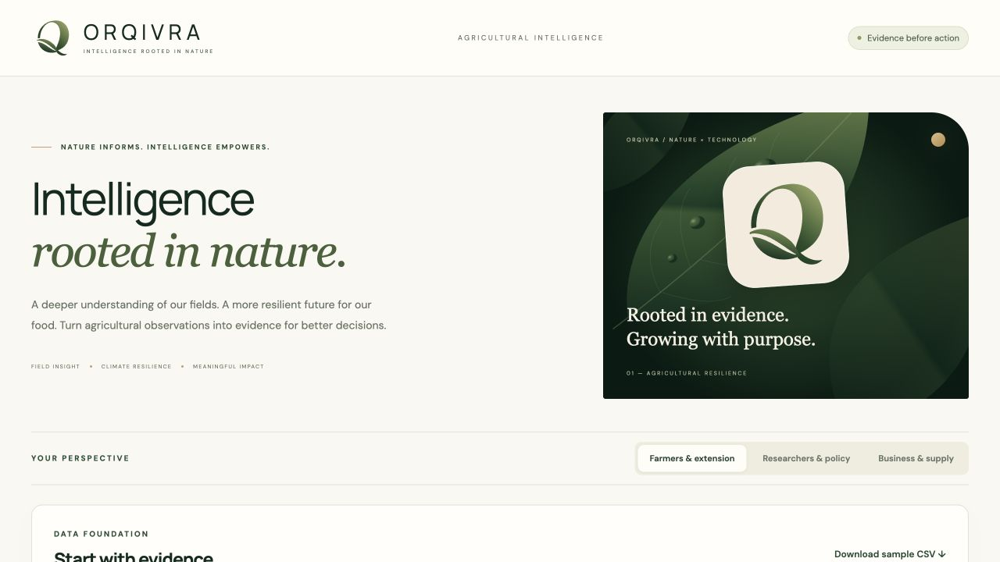
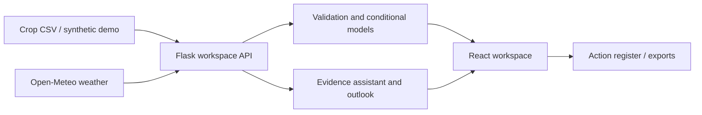

<div align="center">
  
  <h1>ORQIVRA</h1>
  <p><strong>Intelligence rooted in nature.</strong></p>
  <p>An agricultural evidence workspace connecting crop history, regional weather, transparent machine learning and practical follow-up planning.</p>
</div>

## Why this project

Farmers, extension teams, researchers and agricultural businesses need to distinguish useful evidence from unsupported predictions. ORQIVRA combines auditable historical analysis, model validation, current regional conditions and planning tools in one interface. It makes uncertainty and missing data visible.



## What you can explore

- **Regional intelligence:** location search, live weather-model conditions, seven-day forecasts, recent weather history, and modeled soil temperature/moisture using Open-Meteo.
- **Evidence assistant:** answers supported questions using selected crop history, weather and field context; identifies sources and missing evidence; saves suggested investigations as actions.
- **Model evaluation:** six regression candidates with chronological development folds, separate calibration/test sets, baseline comparisons, subgroup errors and nominal prediction intervals.
- **Scenario lab:** conditional yield estimates, local reference comparisons, sensitivity analysis and extrapolation warnings.
- **Crop outlook:** three-year history-only projections chosen through rolling backtests against a last-observed baseline.
- **Operations:** configurable review thresholds, shared-year district comparisons, production/unit calculations and action tracking.
- **Data quality:** CSV validation, row-level exclusion audits, source declarations, dataset fingerprints and downloadable evidence reports.

## Demo walkthrough

1. Select **Explore the resilience demo**, then **Build evidence workspace**.
2. Inspect **Model validation** for held-out error and uncertainty.
3. Open **Regional intelligence**, search for a town, and confirm its state/country.
4. Select a matching historical crop/district and ask the evidence assistant for a summary.
5. Save an investigation to **Operations → Action tracker**, or export a regional brief.

The public deployment uses 192 **synthetic** observations across 2010–2025; it does not claim those crop records were measured in the named districts. Its weather feed is fetched independently from Open-Meteo. Public uploads are disabled; run locally to use your own dataset.

## Technology

**Frontend:** React 18, Recharts, responsive CSS.
**Backend:** Python, Flask, pandas, NumPy, scikit-learn.
**Deployment:** multi-stage Docker, Gunicorn, Render blueprint, GitHub Actions.
**External data:** Open-Meteo geocoding and forecast APIs, with attribution and verified TLS.



## Run locally

Requires Python 3.13 and Node.js 22.

```sh
bash webapp/setup.sh
```

In separate terminals:

```sh
cd webapp/backend
source venv/bin/activate
python app.py
```

```sh
cd webapp/frontend
npm start
```

Open `http://localhost:3000`; the API runs at `http://localhost:5001`.

## Deploy the public demo

A `render.yaml` blueprint defines one **free** Docker web service. The container serves the React build and API from the same origin. Use one Gunicorn worker because workspaces are in memory; four threads handle concurrent requests. Model training is limited to one analysis at a time.

Connect this repository in Render, select Docker and the **Free** instance type, and deploy. No database or paid service is required. Do not enable paid plans or add payment details unless you choose to do so. A free service sleeps after inactivity, so the first request can take about a minute. See [Render's free-instance limits](https://render.com/docs/free).

To test the deployment locally with Docker:

```sh
docker build -t orqivra .
docker run --rm -p 10000:10000 orqivra
```

Open `http://localhost:10000`. To support private uploads, use the local development setup; the container intentionally enables portfolio-demo mode.

## Tests

```sh
python -m unittest discover -s webapp/backend -v
CI=true npm run build --prefix webapp/frontend
```

Tests cover temporal leakage, conformal intervals, extrapolation, cleaning, workspace isolation, operations, missing/stale weather, provider failure and crop-outlook backtests. GitHub Actions repeats the Python suite and frontend build.

## Honest scope

- This is a portfolio/research application, not a validated agricultural advisory service.
- The assistant uses deterministic evidence retrieval and calculations, not a general-purpose LLM.
- Current/soil weather values are model-grid estimates, not farm sensors. Historical district matching is user-selected.
- History-only yield projections do not incorporate future weather, pests or management; displayed stress bounds are not confidence intervals.
- The app does not prescribe pesticide, fertilizer or irrigation doses, diagnose crop disease, or guarantee prediction accuracy.
- Workspace tokens isolate temporary data but are not user accounts. Data/actions expire after two idle hours, can be evicted at capacity, and disappear on restart. Export before leaving.
- Open-Meteo's free endpoint is for non-commercial use. Commercial use requires appropriate provider terms.

[Detailed methodology, data contract and API documentation](webapp/README.md)

## Resume description

Developed ORQIVRA, a full-stack agricultural intelligence platform integrating regional weather APIs, six regression models with chronological validation, an evidence-based assistant, and crop planning workflows. Implemented data-quality audits, uncertainty reporting, backtested yield outlooks, and reproducible Docker deployment.
